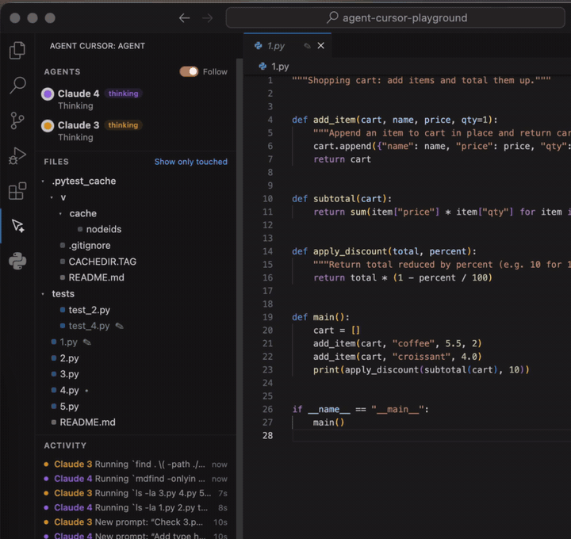

# Agent Cursor

See where your coding agents are working, live, in VS Code. Claude Code, Codex, Gemini CLI, Qwen Code, Cursor, Copilot CLI, OpenCode, Kimi Code and Windsurf.

When an agent reads or edits a file, Agent Cursor shows it like a second person in the file with you:

- **A marker on the line the agent is on**, with what it's doing ("Claude · editing"), pulsing while it works
- **Changed lines glow** in the agent's colour, then fade out over a few seconds
- **Badges in the file explorer**: ✦ where the agent is right now, ✎ files it changed, • files it read
- **An Agent panel** in the sidebar: your files, with the agent's marker sliding from file to file as it moves, and a feed of everything it did
- **Follow mode**: VS Code opens each file the agent moves to and scrolls to where it's working (it waits while you're typing)
- **Every agent has its own look**: ✦ Claude, ⬢ Codex, ✶ Gemini, ◆ Qwen, ▲ Cursor, ◉ Copilot, ▣ OpenCode, ◐ Kimi, ≋ Windsurf, each in its own colour, with a different shade per session, so parallel agents and subagents show up side by side

No setup to learn. Install it, connect your agents once, then just watch.



## Install

1. Install **Agent Cursor**: download the `.vsix` from [Releases](https://github.com/dylannnnn111/agent-cursor/releases) and in VS Code run *Extensions: Install from VSIX...* (Marketplace listing coming)
2. Run **Agent Cursor: Connect Coding Agents** from the Command Palette (or the button in the Agent panel) and tick the agents you use.
3. Start a new session in the folder you have open. Running sessions need a restart to pick up the hooks.

Want to see it first? **Agent Cursor: Run the Demo** plays a made-up session with three agents over the files in your workspace. Nothing is changed on disk.

## Supported agents

| Agent | How it connects | Notes |
|---|---|---|
| ✦ Claude Code | hooks in `~/.claude/settings.json` (or `.claude/settings.local.json`) | Tested live |
| ⬢ Codex CLI | hooks in `~/.codex/hooks.json` | Run `/hooks` in Codex once and trust the hook. Codex reads files through the shell, so reads show up when it uses `cat`, `sed -n`, `head` and the like |
| ✶ Gemini CLI | hooks in `~/.gemini/settings.json` | After-tool events only |
| ◆ Qwen Code | hooks in `~/.qwen/settings.json` | |
| ▲ Cursor (agent + CLI) | `~/.cursor/hooks.json` | After-tool and after-edit events only |
| ◉ GitHub Copilot CLI | `~/.copilot/hooks/agent-cursor.json` | After-tool events only |
| ▣ OpenCode | plugin in `~/.config/opencode/plugins/` | |
| ◐ Kimi Code CLI | `[[hooks]]` in `~/.kimi-code/config.toml` (between marker comments) | |
| ≋ Windsurf (Cascade) | `~/.codeium/windsurf/hooks.json` | |

Everything except Claude Code is built from each agent's hook docs and tested against their documented payloads, not yet against every live agent. If something looks off with yours, open an issue with a line from `~/.agent-cursor/events.jsonl`.

Using DeepSeek, Kimi or another model through one of these agents? It shows up as that agent, with the model name on hover where the agent reports it.

Where an agent's *before* hooks expect an allow/deny answer (Cursor, Copilot, Gemini), Agent Cursor only uses the *after* hooks, so it can never approve or block anything for you.

## How it works

Each agent's hooks run a small script on every tool call. Agent Cursor's script (`hook/hook.js` + `hook/adapters.js`, no dependencies) turns each agent's payload into one common shape, keeps only what the editor needs - which tool, which file, the line range, a short description - and appends it as one line to `~/.agent-cursor/events.jsonl`. The extension follows that file and draws the agent.

- The hooks run with `async: true`, so they never slow the agent down, and the script always exits 0 without printing anything, so it can't change what the agent does.
- Edits are placed by finding the edited text in the file, or from the patch Claude Code reports when there is one.
- Each VS Code window only shows agents working inside its own folders.
- **Nothing leaves your machine.** No network calls, no telemetry. Prompts are cut to 120 characters, code snippets to 4,000, and the log rolls over at 2 MB.

Connecting adds one hook entry per event to that agent's config (a backup is saved next to it the first time). **Agent Cursor: Disconnect Coding Agents** removes them and leaves your own hooks alone.

## Settings

| Setting | Default | |
|---|---|---|
| `agentCursor.follow` | `false` | Open each file the agent moves to |

Colours can be changed under `workbench.colorCustomizations` (`agentCursor.claude`, `agentCursor.codex`, `agentCursor.gemini` and so on).

## Limits

- Agents without a hook system (Aider, Roo Code) can't be shown yet. Anything that can write a line of JSON per action could feed it - see `hook/adapters.js` for the format.
- The file explorer only allows a one-character badge and a colour, so the moving marker lives in the Agent panel.
- Needs Node.js on your machine for the hook (not for OpenCode, which runs it as a plugin). Without Node, on macOS and Linux it falls back to VS Code's own runtime.

## Develop

```sh
npm install
npm test          # unit tests (node:test)
npm run package   # builds agent-cursor-<version>.vsix
```

Press F5 in VS Code to open an Extension Development Host with it loaded.

MIT licence. Built by [Dylan Lewis](https://dylanlewis.au).
